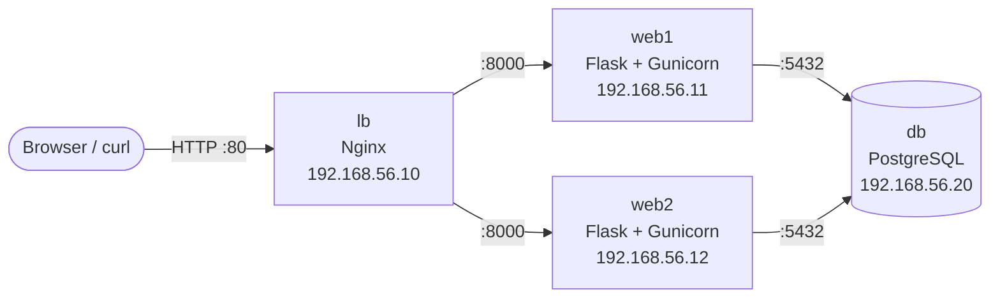

# Vagrant three-tier lab

A production-style web stack on 4 virtual machines, built with one `vagrant up`:
a load balancer, two web servers and a database, each on its own isolated network rule.
A test script then proves the stack works, including **failover when a web server dies**.



## What it shows

| Practice | How |
|----------|-----|
| Infrastructure as code | The 4 VMs, their network and their software come from the [Vagrantfile](Vagrantfile) and 3 Bash scripts |
| High availability | Nginx spreads requests over both web servers and skips one that stops answering |
| Network segmentation | `ufw` firewalls: the database only accepts the web servers, the web servers only accept the load balancer |
| Secrets out of Git | The database password is generated on first boot and ignored by Git |
| Idempotent provisioning | Running `vagrant provision` again changes nothing and breaks nothing |
| Services that restart themselves | The app runs as a `systemd` service with `Restart=always`, under its own unprivileged user |
| Automated testing | [tests/smoke-test.sh](tests/smoke-test.sh) checks the stack end to end |

## Run it

You need [VirtualBox](https://www.virtualbox.org/) and [Vagrant](https://www.vagrantup.com/), and about 3 GB of free RAM.

```bash
vagrant up                 # about 8 minutes the first time
bash tests/smoke-test.sh   # from Git Bash on Windows, or any Linux/macOS shell
```

Expected output:

```
1. Health check through the load balancer
2. Traffic reaches both web servers
3. The counter is shared through the database
4. The web servers are not reachable directly
5. Failover: stop web1, every request must still succeed
PASS: all checks succeeded
```

Try it by hand: `curl http://192.168.56.10/` several times and watch `served_by` alternate between `web1` and `web2` while `visits` keeps counting.

Clean up with `vagrant destroy -f`.

## Repository layout

```
Vagrantfile          4 VMs, private network, boot order, generated DB password
provision/db.sh      PostgreSQL, access limited to the web servers
provision/web.sh     Python venv, Gunicorn systemd service
provision/lb.sh      Nginx upstream with passive health checks
app/                 Flask visit counter (/ and /healthz) and its SQL schema
tests/smoke-test.sh  End-to-end and failover test
```

## Problems solved along the way

- **Scripts written on Windows break on Linux** because of CRLF line endings. [.gitattributes](.gitattributes) forces LF on every `.sh` file.
- **CentOS 7 is end-of-life** and its package mirrors are gone, so the lab uses Ubuntu 22.04.
- **Disk space**: `linked_clone` makes the 4 VMs share one base disk instead of copying it 4 times.
- **Making a script safe to re-run**: every step checks first (the role exists? the rule is already there?) before changing anything.

## Next

The same stack is rebuilt with Ansible in the next project, then containerized, deployed by a CI/CD pipeline and finally run on Kubernetes.
